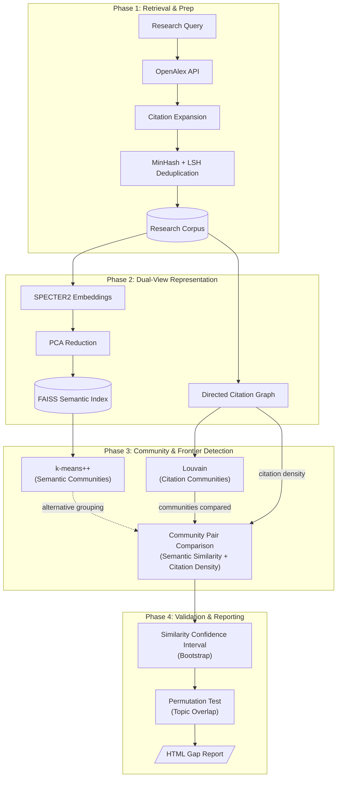

# Research Gap Discovery (RGD)

> **Bridging disconnected academic communities by pairing semantic similarity with citation graphs to reveal high-potential research frontiers.**

**Authors:** Vedant Acharya (23110010) & Bhavya Parmar (23110059)  
**Course:** CS328 - Introduction to Data Science, IIT Gandhinagar

---

## Motivation

Researchers entering an unfamiliar or rapidly evolving field struggle to efficiently sift through thousands of papers and discover genuine research gaps. Relying on raw citation counts introduces strong historical bias toward older works, while keyword searches fail to capture cross-disciplinary overlap.

This leaves researchers blind to **isolated academic silos**, where distinct communities solve the same fundamental problem without citing each other, making pinpointing unaddressed research frontiers a slow, manual process.

To address these limitations, **RGD** combines dense semantic similarity with citation-network topology to map the research landscape beyond conventional keyword and citation-based search. By identifying semantically related but weakly connected research communities and validating these patterns statistically, our pipeline isolates candidate research frontiers and overlooked cross-disciplinary opportunities.

---

## System Architecture & Workflow

The pipeline is organized into four sequential phases:



---

## Repository Structure

```
Project/RGD/
├── README.md                      # Comprehensive project documentation
├── requirements.txt               # Python package dependencies
├── .env.example                   # Template for .env (OpenAlex API key)
├── .gitignore                     # Git ignore rules for data, models, and environments
├── config.yaml                    # Pipeline settings
├── docs/                          # Method notes and OpenAlex API guide
├── report/                        # Project report (main.tex, main.pdf)
├── runs/pinn/                     # Example run: config, corpus, embeddings and reports
├── data/                          # Data storage (git-ignored)
│   ├── raw/                       # Initial OpenAlex JSON/CSV outputs
│   └── processed/                 # Stored corpus after duplicate removal and expansion
├── models/                        # Saved artifacts (git-ignored)
│   ├── embeddings/                # Serialized SPECTER2 embeddings and PCA models
│   └── faiss_indices/             # Compiled FAISS index files
├── notebooks/                     # Exploratory notebooks for testing individual components
└── src/
    ├── __init__.py
    ├── phase1_acquisition/        # Literature Retrieval & Acquisition
    │   ├── __init__.py
    │   ├── openalex_fetch.py      # Initial query retrieval and citation-link expansion
    │   └── deduplication.py       # MinHash and LSH duplicate removal
    ├── phase2_representation/     # Semantic & Citation Representation
    │   ├── __init__.py
    │   ├── embed_specter.py       # SPECTER2 generation and PCA dimensionality reduction
    │   ├── faiss_index.py         # Construction of the semantic similarity index
    │   └── citation_graph.py      # Citation graph construction
    ├── phase3_detection/          # Community & Frontier Detection
    │   ├── __init__.py
    │   ├── semantic_cluster.py    # Detection of semantic communities
    │   ├── graph_cluster.py       # Detection of citation communities
    │   └── frontier_scoring.py    # Community comparison to isolate candidate frontiers
    ├── phase4_validation/         # Validation & Analysis
    │   ├── __init__.py
    │   ├── hypothesis_test.py     # Similarity confidence interval and permutation test
    │   └── report.py              # HTML gap report
    └── pipeline.py                # Main orchestrator to run phases sequentially
```

---

## Quick Start

### 1. Environment Setup

Create and activate a virtual environment:

```bash
# Windows (PowerShell)
python -m venv venv
.\venv\Scripts\Activate.ps1

# Linux / macOS
python3 -m venv venv
source venv/bin/activate
```

Install dependencies:

```bash
pip install -r requirements.txt
```

### 2. Configure Environment

Copy the template and add your OpenAlex key:

```bash
cp .env.example .env
```

Since Feb 13, 2026, OpenAlex requires a free API key (100,000 credits/day). Without one, access is capped at 100 credits/day. An email address is no longer needed. See [docs/openalex_api.md](docs/openalex_api.md) for request formats, response structure and parsing details.

### 3. Run the Pipeline

Run from the project root (paths in `config.yaml` are relative to it):

```bash
python src/pipeline.py \
  --query "physics-informed neural networks" \
  --must-include "physics-informed|PINN|PINNs" "neural network|neural networks" \
  --max-seeds 100
```

- `--must-include`: every term must appear in the title or abstract of seed papers; `|` separates alternatives, quotes mark phrases.
- `--filter-expanded`: also apply `--must-include` to papers added by citation expansion.
- Prefix with `HF_HUB_OFFLINE=1` to skip Hugging Face update checks once SPECTER2 is downloaded.

Open the results:

```bash
xdg-open reports/frontier_report.html   # Linux (macOS: open, Windows: start)
```

The tables behind the report are `reports/validated_frontiers.csv` and `reports/isolated_paper_pairs.csv`.

The results of this query used in the project report are committed in `runs/pinn/` (open `runs/pinn/reports/frontier_report.html`). Add `--config runs/pinn/config.yaml` to reproduce them into that folder.

#### Mock Mode

Runs the pipeline on a synthetic corpus without calling OpenAlex (SPECTER2 is still loaded). It writes to the same `reports/` folder:

```bash
python src/pipeline.py --query "graph neural networks" --max-seeds 30 --mock
```

---

## Configuration Reference (`config.yaml`)

| Parameter Section | Key Parameters | Description |
| :--- | :--- | :--- |
| **`acquisition`** | `max_references_per_paper` | References of each seed paper added during citation expansion |
| **`deduplication`** | `jaccard_threshold`, `lsh_threshold`, `num_perm`, `shingle_size` | Duplicate cutoff (exact Jaccard), LSH candidate cutoff, MinHash settings |
| **`representation`** | `specter.model_name`, `pca.n_components`, `faiss.metric` | SPECTER2 model, PCA target dimensions (default 64), FAISS distance |
| **`detection`** | `semantic_clustering.n_clusters`, `graph_clustering.resolution` | k-means++ and Louvain community parameters |
| **`detection`** | `frontier_scoring.community_col`, `similarity_percentile`, `max_density_ratio` | Which communities are compared, paper-pair similarity cutoff, and "low citation" relative to the graph average |
| **`validation`** | `similarity_ci.n_iterations`, `hypothesis_test.n_permutations`, `hypothesis_test.alpha` | Bootstrap samples for the similarity CI, permutations and p-value cutoff |

---

## Outputs & Reports

Outputs are written to `reports/`, with intermediate files in `data/` and `models/`:
- `reports/frontier_report.html`: Self-contained gap report: citation graph coloured by community (most typical paper of each community highlighted), community frontiers with similarity CI and p-value, and isolated paper pairs. Paper titles link to the paper.
- `reports/validated_frontiers.csv`: Ranked community frontiers with similarity confidence intervals and permutation-test p-values.
- `reports/isolated_paper_pairs.csv`: Highly similar paper pairs with no citation between them.
